<div align="center">


# 启笔 QIBI · AI 小说编辑器

**把一部小说，拆成可以下笔的十道工序。**

夜色水墨的桌面级写作工作台 —— 十二屏界面 + 一个跑在本机的 Node 后端<br />
零前端依赖 · 零构建 · 数据与密钥都留在你自己的磁盘上

[快速开始](#快速开始) · [界面巡览](#界面巡览) · [后端](#后端在做什么) · [数据与隐私](#数据与隐私)

</div>

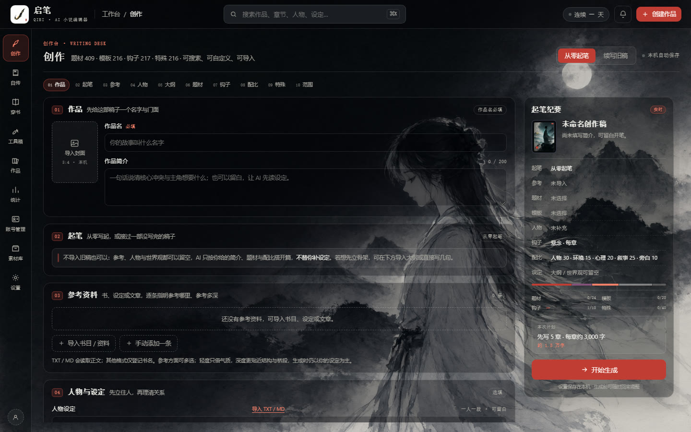

---

## 这是什么

写长篇小说，难的往往不是「写」，是「想起来」：设定散落在几个笔记软件里，人物关系靠脑子记，钩子和节奏全凭当天的手感。

**启笔**把这些东西摁进一张工作台：左栏是目次（创作 · 自传 · 穿书 · 工具箱 · 作品 · 统计 · 账号 · 素材 · 设置），
中间是当下这一道工序，右边是「起笔纪要」——你填进去的每一样东西，都会实时汇总成开工前的清单。

它由三块拼成：

| 层 | 是什么 | 位置 |
|---|---|---|
| **界面** | 12 个自包含 HTML，约 2.7 万行、零外部资源 | 仓库根目录 `*.html` |
| **后端** | 1346 行 Node 服务，只用内置模块（`http` / `fs` / `path`），代理大模型、管作品与记忆 | `qibi-server.cjs` |
| **桌面壳** | Electron 主进程，起一个空闲端口、内嵌服务、开窗口 | `desktop/main.js` |

### 一次开篇的十道工序

题材 409 · 模板 216 · 钩子 217 · 特殊 216 —— 这些不是装饰性数字，而是工作台里真正可检索、可自定义、可导入的库：

`01 作品` → `02 起笔` → `03 参考` → `04 人物` → `05 大纲` → `06 题材` → `07 钩子` → `08 配比` → `09 特殊` → `10 范围`

作品名是唯一必填项；其余全部可以留白。这是刻意的：**AI 不替你补设定**，它只按你给的骨架起笔。

---

## 快速开始

### 方式一：完整功能（推荐）

需要 [Node.js](https://nodejs.org/) 18+。**不需要 `npm install`** —— 后端零依赖。

```bash
node qibi-server.cjs
# 然后在浏览器打开 http://127.0.0.1:9300
```

或用 npm 脚本：

```bash
npm start
```

### 方式二：桌面应用

```bash
npx electron .
```

首次运行会自动装 Electron（约 100MB）。它会自己找一个空闲端口启动内置服务，作品数据落在 `%APPDATA%\启笔\data`。

### 方式三：只想看界面

直接双击 `index.html`，或用任意静态服务器。此时**没有 AI、没有作品存储**——纯看界面，见 [静态预览的边界](#部署到-github-pages)。

### 接上模型

打开 **设置 → AI 接入**，填自己的 Key（会存进本机 `data/db.json`，不会上传到任何地方）：

- 对话模型：DeepSeek，默认 `deepseek-flash`
- 生图模型（可选）：Qwen Image，走 `maas.qianwenaiapi.com` 兼容接口

也可以不用界面，把配置写进 `data/config.json`：

```json
{
  "port": 9300,
  "deepseekBase": "https://api.deepseek.com",
  "deepseekKey": "",
  "deepseekModel": "deepseek-flash"
}
```

配置读取优先级：**界面里保存的设置 → `data/config.json` → 环境变量**（`DEEPSEEK_API_KEY` / `QWEN_API_KEY` / `QIBI_PORT` 等）。
`config.sample.json` 是一份空模板，所有 Key 都留空——仓库里不含任何密钥。

---

## 界面巡览

### 创作台 · 十道工序，一道一屏

左栏目次、中央工序卡、右侧纪要三栏并行。每一道工序都只问一件事，填完接着走下一道。


### 编辑器 · 正文、大纲、记忆同屏

左栏是章节树，中间是稿纸，右侧面板在「文稿 / 大纲 / 参考资料 / 记忆 / 人物 / 设定」之间切换；
还有一个常驻的 AI 写作助手，不选工具时走通用写法，选了工具就按该工具的产出结构生成。
导出支持 Markdown 与纯文本，可按卷、按章打包 ZIP —— **文件在本机生成，不上传云端**。

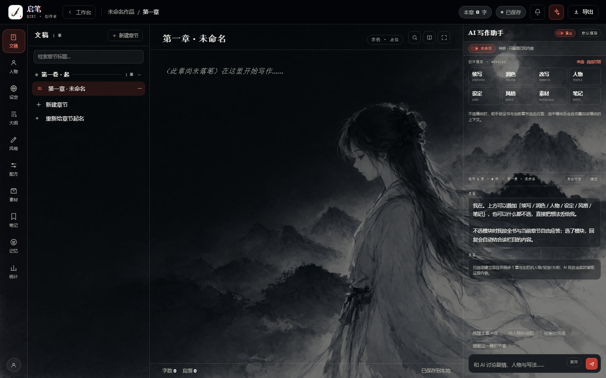

### 穿书 · 把自己写进别人的书里

选底本（内置书库里就有红楼梦）、挑穿法（12 种）、认领身份，再决定从哪一章开始改写。

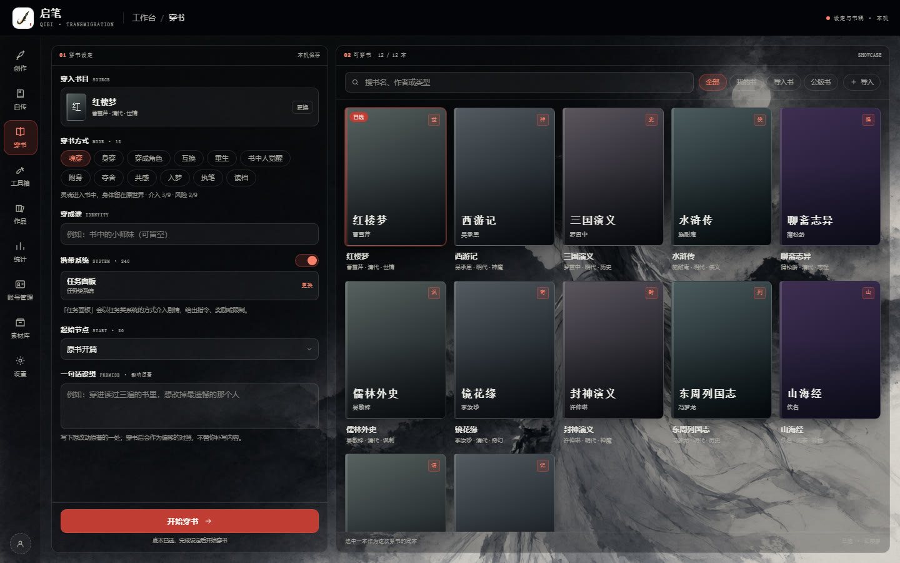

### 自传 · 讲出来的事，自动变成书稿

和「老师」对谈，回复长度可设自适应；对话、书稿与设置只留在本机。

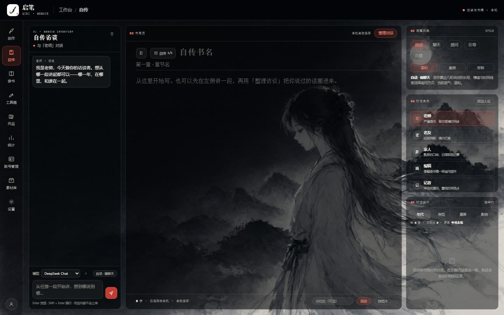

### 其余八屏

| | |
|---|---|
| **模式开局台**<br />属性 · 人物 · 事件 · 设定四步定调，也可以一键写整本<br />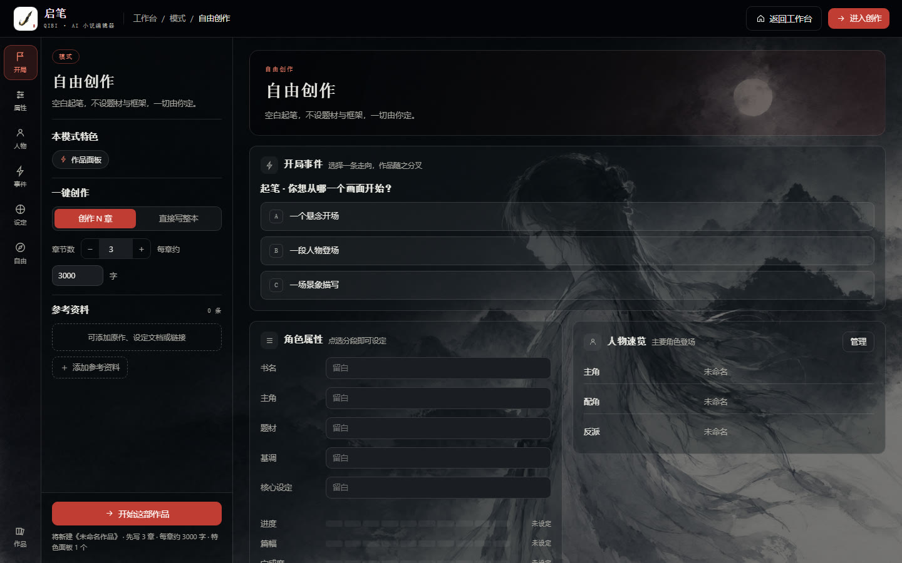 | **工具箱**<br />设定、结构与辅助创作，每件工具在独立工作页打开<br />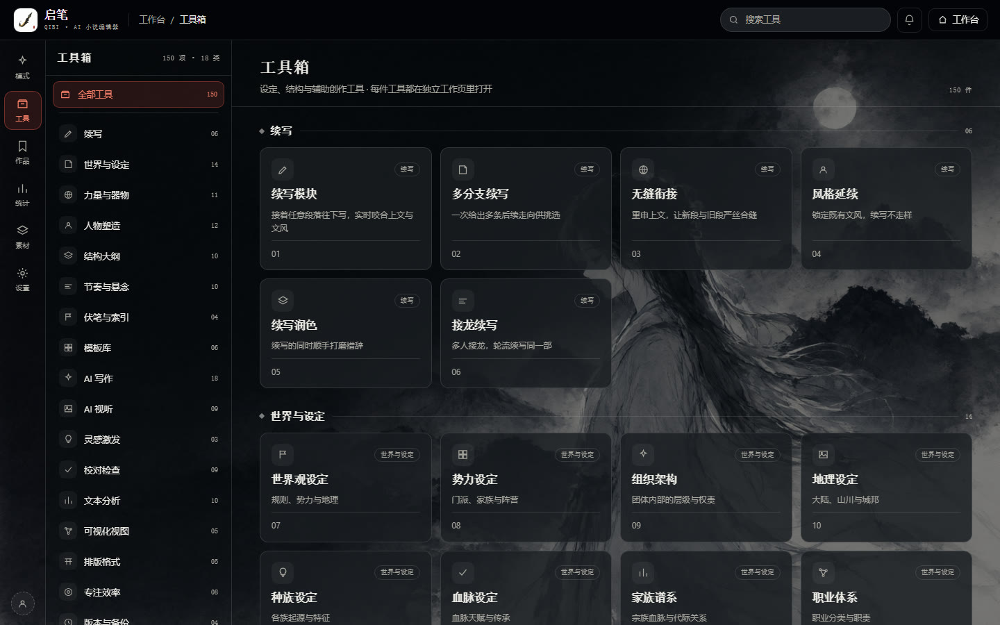 |
| **工具工作页 · 续写**<br />接着任意段落往下写，实时咬合上文与文风<br />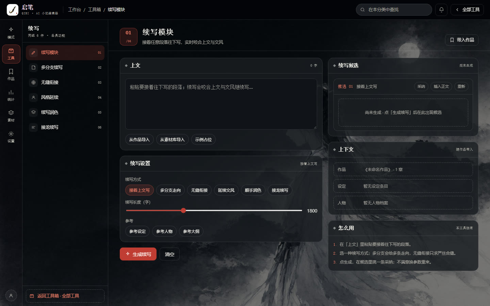 | **作品书架**<br />草稿本机自动存档，封面、简介与章节一览<br />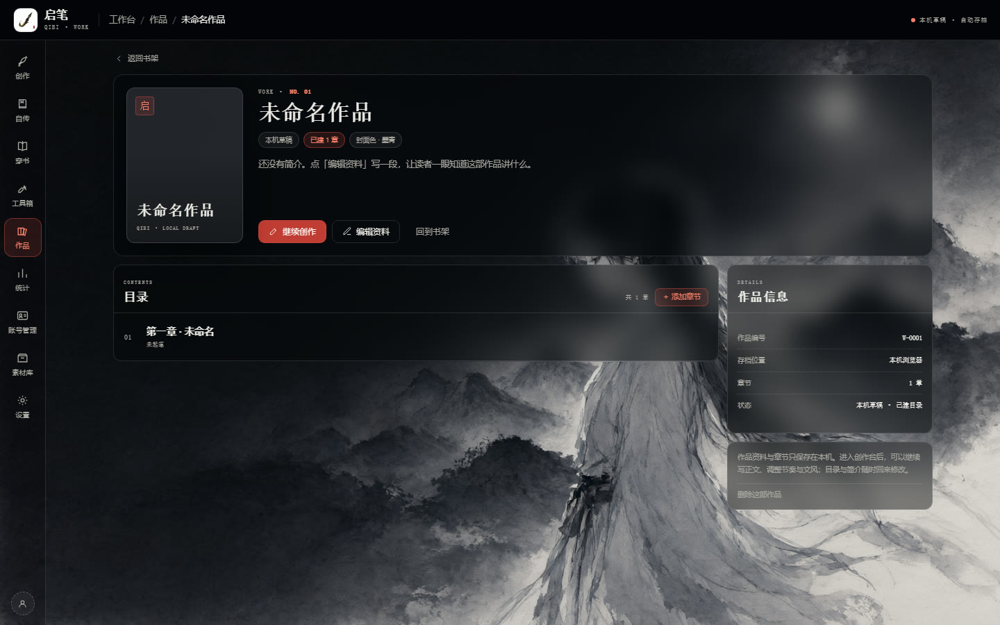 |
| **统计**<br />十类一百二十项写作指标，环形切换模块<br />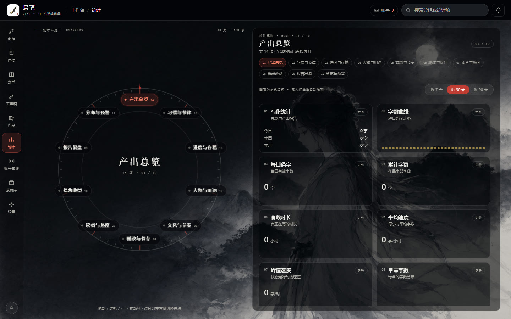 | **素材库**<br />按题材归类的可复用素材，卡片原位展开<br />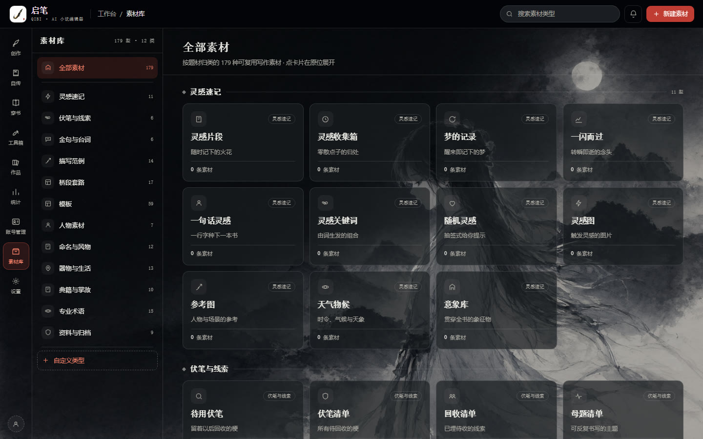 |
| **账号管理**<br />多平台账号只用于本地统计归属，不代登录、不存凭据<br />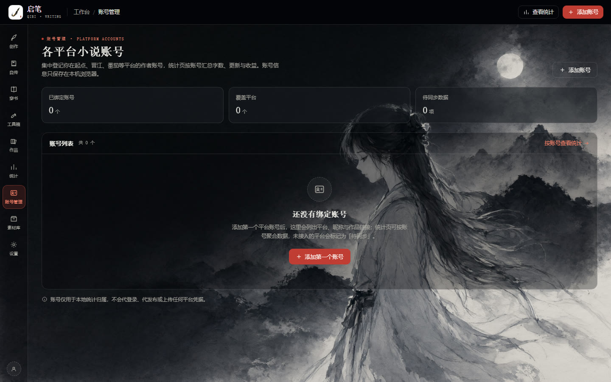 | **设置**<br />十五项六类偏好，含模型接入配置<br />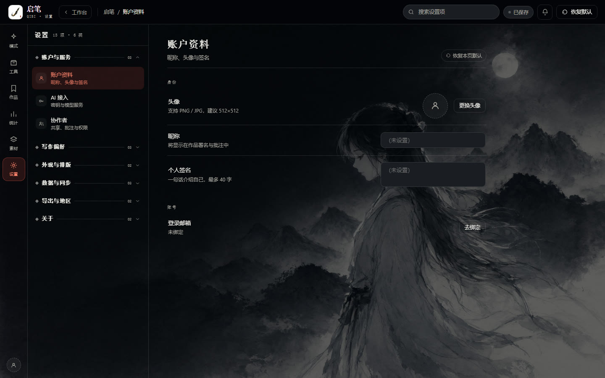 |

---

## 后端在做什么

一个 1346 行的单文件 Node 服务，同时干三件事：**管数据**、**代理模型**、**发静态文件**。

| 接口 | 作用 |
|---|---|
| `GET/POST /api/projects` | 作品列表 / 新建 |
| `GET/PATCH/DELETE /api/projects/:id` | 单部作品的读写与删除 |
| `POST /api/projects/:id/chapter` | 章节保存（自动建/更新本章记忆） |
| `GET/PUT /api/projects/:id/memory` | 结构化记忆：书目、分卷、人物、设定、伏笔、状态 |
| `POST /api/projects/:id/memory/build` | 分批蒸馏章节摘要，再逐层汇总 |
| `POST /api/projects/:id/memory/check` | 一致性检查（人物、时间线、设定冲突） |
| `POST /api/projects/:id/plan` | 大纲规划 |
| `POST /api/ai/chat/stream` | 对话与生成，SSE 流式返回（`text/event-stream`） |
| `POST /api/ai/image` | 生图（Qwen Image 兼容接口） |
| `POST /api/ai/tts` | 语音合成（调用本机 Python + `edge-tts`，缺失时降级） |
| `POST /api/ai/search` | 联网检索辅助设定 |
| `GET/PUT /api/settings` | 模型与偏好设置 |
| `GET /api/stats` · `POST /api/writelog` | 写作统计与写作日志 |
| `GET /api/backup` | 整库导出 |

### 长篇记忆是怎么撑住的

这是这套东西最不"界面"的部分：写到几十万字，模型不可能每次都读全文。

所以保存章节时，服务端会把这一章**蒸馏成摘要**，抽出人物、设定、伏笔的变化，写进结构化记忆；
生成时只挑相关的几条记忆 + 上一章尾巴拼成**上下文包**，喂给模型。章节多了再逐层向上汇总，
避免"记忆"本身也变成一坨读不完的文本。

### 音频（可选）

- `sfx.py` — 纯标准库合成环境声（雨、风、夜虫），没有 Python 时服务端会用 Node 现场合成 WAV 兜底
- `tts.py` — 需要 `pip install edge-tts`，用于朗读与配音

---

## 设计语言

一套 **夜色水墨** 的视觉系统：把一张水墨夜色铺在整块工作台底下，所有界面都是浮在上面的墨色玻璃。

| | |
|---|---|
| **底色** | 夜墨 `oklch(15% 0.010 262)`，宣纸白文字 `oklch(94% 0.006 90)` |
| **唯一强调色** | 朱砂 `oklch(55% 0.17 28)` —— 全站只有它能「亮」 |
| **色值规范** | 只用 `oklch()` 与 `color-mix()` 派生，**没有一处裸 hex** |
| **字体** | 标题衬线（Iowan / Charter / 宋体栈）· 正文系统无衬线 · 数字等宽 |
| **结构** | 「目次」式左栏 + 单列工序流，像一本可以翻的书，而不是一屏仪表盘 |
| **动效** | 250ms 内、以位移与透明度为主；响应 `prefers-reduced-motion` |

---

## 目录结构

```
.
├── index.html                  # 落地页（目录 + 后端连通性指示灯）
├── ai-novel-editor-home.html   # 01 创作台 · 十道工序
├── qibi-studio.html            # 02 编辑器
├── qibi-mode.html              # 03 模式开局台
├── qibi-transmigration.html    # 04 穿书
├── qibi-memoir.html            # 05 自传
├── qibi-tools.html             # 06 工具箱
├── qibi-tool.html              # 07 工具工作页
├── qibi-work.html              # 08 作品书架
├── qibi-stats.html             # 09 统计
├── qibi-materials.html         # 10 素材库
├── qibi-accounts.html          # 11 账号管理
├── qibi-settings.html          # 12 设置
├── qibi-server.cjs             # 本地后端：数据 / 模型代理 / 静态服务
├── qibi-avatar.js              # 头像生成
├── config.sample.json          # 配置模板（Key 全空）
├── sfx.py · tts.py             # 环境声 / 语音合成（可选）
├── app-icon.png · app-icon.ico · 水墨少女-夜色.png · 启笔-封面-惊鸿照影-1.png
├── desktop/
│   └── main.js                 # Electron 主进程
├── screenshots/                # README 用界面截图
└── docs/
    ├── DESIGN-HANDOFF.md       # 设计交接：视觉契约与实现要求
    ├── DESIGN-MANIFEST.json    # 机器可读地图：12 屏 / 9 档断点 / token 清单
    └── ai-model-pricing-2026.txt  # 立项时的模型选型调研
```

## 数据与隐私

这一套是**单机软件**，不是云服务：

- 作品、章节、记忆、设置全部落在 `data/db.json`（桌面版在 `%APPDATA%\启笔\data`），**没有账号、没有同步、没有上传**
- 仓库里**不含任何密钥、任何作品数据**；`data/`、`config.json`、`db.json` 已在 `.gitignore` 中
- 服务只监听 `127.0.0.1`，且 CORS 只放行本机来源 —— 应用运行时，别的网站读不到你的 `/api/settings`
- 唯一会往外发请求的动作，就是你自己点「生成」时把上下文交给模型供应商
- 导入的 TXT / MD / 图片都在浏览器或本机进程里处理，不经过第三方

## 部署到 GitHub Pages

仓库里带了 `.nojekyll`，可以直接开 Pages：**Settings → Pages → Deploy from a branch → `main` / `(root)`**。

但要说清楚：**Pages 只能放静态文件，跑不了 Node 后端**。所以在 Pages 上：

- ✅ 十二屏界面都能打开、能点、能翻
- ❌ 不能保存作品、不能调用模型（请求 `/api/*` 会 404）

落地页左下角那盏小灯就是给这个用的：**绿色 = 后端已连接**，橙色 = 静态预览。
想要完整功能，请按 [方式一](#快速开始) 在本地跑起来。

## 已知边界

诚实地写下来，免得你试的时候以为是 bug：

- **桌面优先**：以 1440×900 为设计基准，十二屏均为桌面布局；手机（390px）打开会横向溢出，移动端适配尚未开始
- **单机单人**：没有登录、没有多人协作、没有云同步
- **模型只接了 DeepSeek + Qwen Image**：换别的供应商需要改 `qibi-server.cjs` 里的适配层
- **统计里的读者热度、稿费收益**需要平台数据源，界面上已明确标注「暂无数据源」

## 文档

- [`docs/DESIGN-HANDOFF.md`](docs/DESIGN-HANDOFF.md) —— 把这批文件当「视觉契约」看待：字号阶梯、间距节奏、色值令牌、圆角阴影、动效时长都不应被重新诠释
- [`docs/DESIGN-MANIFEST.json`](docs/DESIGN-MANIFEST.json) —— 机器可读清单：12 个屏幕角色、9 档响应式断点（360 → 1920）、必需的交互状态
- [`docs/ai-model-pricing-2026.txt`](docs/ai-model-pricing-2026.txt) —— 立项时的模型选型调研（语言 / 生图 / TTS 三条线）

## 许可

以 **Apache License 2.0** 发布（完整文本见仓库根目录 [`LICENSE`](LICENSE)）。

可自由使用、修改与商用，保留版权与许可声明、并注明修改即可。

---

<div align="center">
<sub>底色是作者本人的水墨画 · 朱砂只点一处</sub>
</div>
